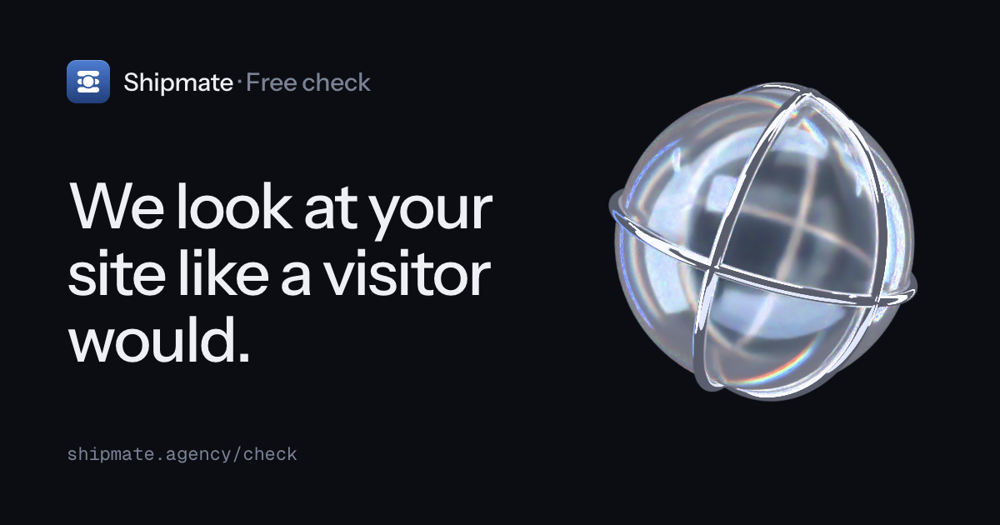

<p align="center">
  <a href="https://shipmate.agency/rules/">
    
  </a>
</p>

# ShipReady MCP Server — Local Security Checks for Cursor & Claude Code

<!-- mcp-name: agency.shipmate/shipready-mcp -->

[](https://shipmate.agency)
[](./server.json)
[-11141C?style=flat-square)](./server.py)
[](./LICENSE)

**ShipReady MCP** runs [Shipmate's](https://shipmate.agency) pre-launch security checks directly inside **Cursor**, **Claude Code**, and **Windsurf**. It scans local repositories for the vulnerabilities most frequently shipped in AI-built **Next.js, Supabase, and Stripe** apps — 100% locally with zero dependencies and zero code leaving your machine.

## What `shipready_scan_repo` Detects
| Rule ID | Severity | What It Catches | Docs |
|---|---|---|---|
| `SR-SUPA-001` | Medium | SQL table created without `ENABLE ROW LEVEL SECURITY` | [Fix guide](https://shipmate.agency/rules/supabase-missing-rls/) |
| `SR-SUPA-002` | Medium | Write RLS policy using `USING (true)` | [Fix guide](https://shipmate.agency/rules/supabase-policy-using-true/) |
| `SR-SUPA-003` | High | Supabase `service_role` key exposed in source | [Fix guide](https://shipmate.agency/rules/supabase-service-role-key-exposed/) |
| `SR-SEC-001` | High | Server secret in `NEXT_PUBLIC_` / `VITE_` env var | [Fix guide](https://shipmate.agency/rules/secret-in-public-env-var/) |
| `SR-SEC-002` | High | Hardcoded live Stripe, OpenAI, Anthropic, or GitHub key | [Fix guide](https://shipmate.agency/rules/hardcoded-api-key/) |
| `SR-SEC-003` | Medium | `.env` file present and not in `.gitignore` | [Fix guide](https://shipmate.agency/rules/env-file-not-gitignored/) |
| `SR-PAY-001` | Medium | Stripe webhook handler missing `constructEvent` | [Fix guide](https://shipmate.agency/rules/stripe-webhook-no-signature-check/) |

## Quick Install

ShipReady MCP is not published on PyPI or npm yet, so install it from this repository. Needs Python 3.10+.

```bash
git clone https://github.com/Shipmate-agency/shipready-mcp
```

Then point your client at the absolute path of `server.py` in that clone (replace `/path/to/shipready-mcp` below). With [uv](https://docs.astral.sh/uv/) you can skip the clone and use `"command": "uvx", "args": ["--from", "git+https://github.com/Shipmate-agency/shipready-mcp", "shipready-mcp"]` instead.

### Cursor (`.cursor/mcp.json` in your project, or `~/.cursor/mcp.json`)
```json
{
  "mcpServers": {
    "shipready": {
      "command": "python3",
      "args": ["/path/to/shipready-mcp/server.py"]
    }
  }
}
```

### Claude Code
```bash
claude mcp add shipready -- python3 /path/to/shipready-mcp/server.py
```

### Windsurf (`~/.codeium/windsurf/mcp_config.json`)
```json
{
  "mcpServers": {
    "shipready": {
      "command": "python3",
      "args": ["/path/to/shipready-mcp/server.py"]
    }
  }
}
```

Then ask the agent to run `shipready_scan_repo` on your project directory. The scanner checks the seven rules in the table above; `shipready_list_rules` lists all 14 ShipReady rules; the other seven (HTTP headers, exposed dotfiles, public schema) need a live deployment and are not checked locally.

### Included IDE Guardrails
- [`rules/shipmate-security.mdc`](./rules/shipmate-security.mdc) — Cursor rule; copy it into your project's `.cursor/rules/`
- [`cursorrules.txt`](./cursorrules.txt) — Drop-in `.cursorrules` security invariants
- [`CLAUDE.security.md`](./CLAUDE.security.md) — Drop-in Claude Code security section

## Static Scan vs. Human Security Review
Automated checks catch known patterns, not business-logic IDOR, multi-tenant authorization bypasses, or billing edge cases.
- **Free passive surface check ($0, no card):** https://shipmate.agency/check
- **Launch Lockdown ($950 once, 1 PR) · Pentest + Letter ($2,950 once):** https://shipmate.agency
- **Related:** [`shipready` CLI & GitHub Action](https://github.com/Shipmate-agency/shipready) · [`awesome-vibe-code-security`](https://github.com/Shipmate-agency/awesome-vibe-code-security)
